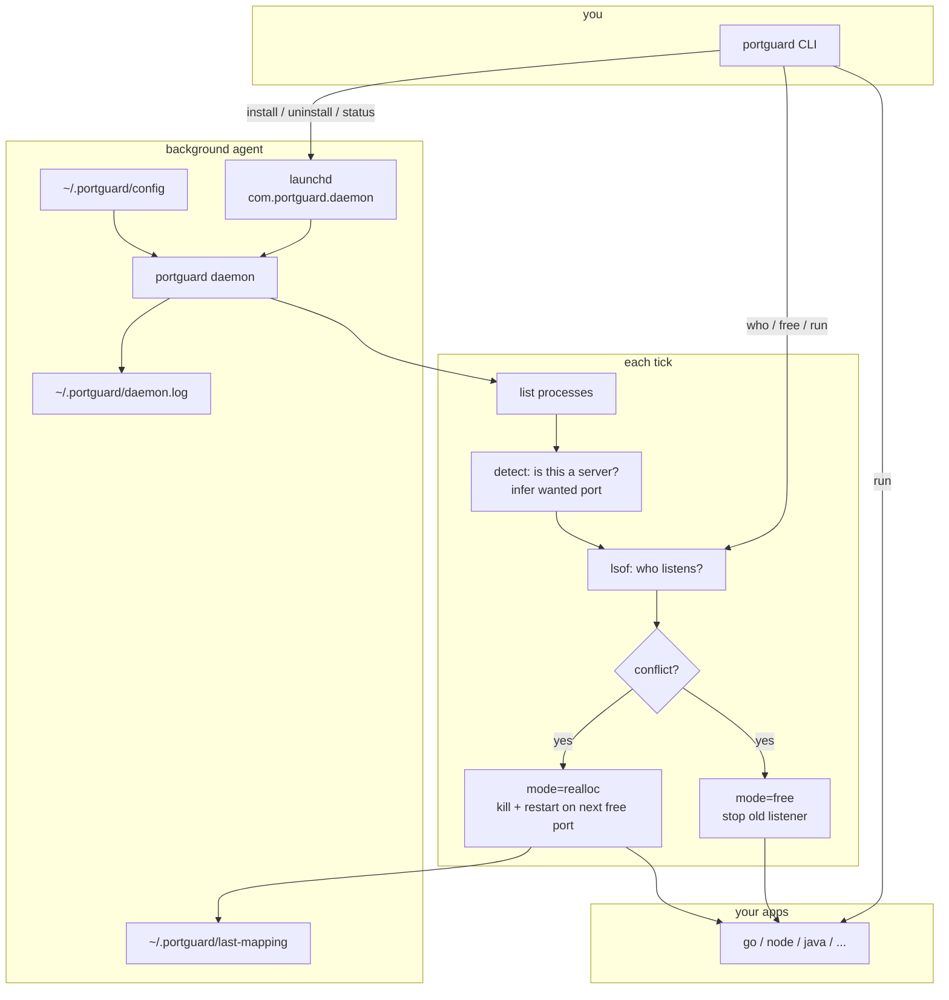
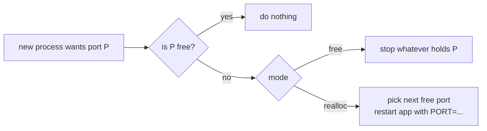

# portguard

Local helper that keeps your app ports from fighting each other.

Think of ports like seats in a classroom. If someone is already sitting in seat `8080`, portguard either asks them to leave (`free`) or finds you the next empty seat (`realloc`).

macOS only for the background agent (uses `launchd` + `lsof`).

## architecture



### conflict flow



### modules

| module | job |
| --- | --- |
| `main` | CLI entry (`install`, `daemon`, `who`, `free`, `run`, ...) |
| `install` | write launch agent plist, load/unload via `launchctl` |
| `daemon` | watch new processes and resolve port conflicts |
| `detect` | guess wanted port from cmdline, `.env`, or Go sources |
| `port` | `lsof`, free/find ports, protect system/db ports |
| `run` | one-shot: prepare port, then exec your command |
| `config` | `~/.portguard/config` (`mode`, `interval_ms`) |

## install

```bash
cargo install --path .
portguard install
portguard status
```

Uninstall the agent:

```bash
portguard uninstall
```

## usage

### background mode (default after install)

1. Start your app normally (`go run .`, etc.).
2. Daemon notices it wants a busy port.
3. Depending on config:
   - `realloc` (default): restarts the app on the next free port and sets `PORT` / `SERVER_PORT` / `APP_PORT` / `PORTGUARD_PORT`
   - `free`: stops the old listener so your app can keep the preferred port

### manual one-shot

```bash
# keep port 8080 (stop whoever holds it, unless protected)
portguard run --port 8080 -- go run .

# if busy, pick next free port and inject env
portguard run --port 8080 --realloc -- go run .
```

### inspect / free a port

```bash
portguard who 8080
portguard free 8080
portguard free 5432 --force   # protected ports need --force
```

## config

Created at `~/.portguard/config` on install:

```
# realloc = move new app to a free port (default)
# free    = stop old process and keep the requested port
mode=realloc
interval_ms=800
```

## safety

Protected ports (need `--force` to free): `22`, `53`, `80`, `443`, `3306`, `5432`, `6379`, `27017`.

The daemon skips protected ports entirely.

## license

MIT
